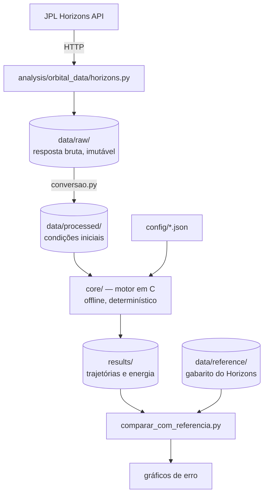

# Simulador Orbital

Simulador do Sistema Solar que calcula o movimento dos planetas a partir das leis da física e **compara o resultado com as efemérides da NASA (JPL Horizons)**. O objetivo não é só desenhar órbitas: é medir, com números, quanto erro cada simplificação física introduz.

Mais adiante, o mesmo motor vai simular asteroides e foguetes.

> 🚧 **Em reestruturação.** O projeto foi reorganizado do zero (veja [Arquitetura](docs/arquitetura.md)). O código da primeira versão está guardado em [`legacy/`](legacy/) e será migrado para a nova estrutura.

---

## Sumário

1. [A ideia científica](#-a-ideia-científica)
2. [Como o projeto funciona](#️-como-o-projeto-funciona)
3. [Estrutura de pastas](#-estrutura-de-pastas)
4. [Como executar](#-como-executar)
5. [Roadmap](#️-roadmap)
6. [Documentação](#-documentação)
7. [Créditos](#-créditos)

---

## A ideia científica

**Efeméride** é uma tabela da posição e da velocidade de corpos celestes ao longo do tempo. As efemérides do JPL (versão DE440) são o padrão usado pela NASA para navegar sondas. Elas vêm de um modelo físico completo ajustado a décadas de observações.

Este projeto usa o Horizons de duas formas:

- **Ponto de partida.** As posições e velocidades reais de todos os planetas numa data (as *condições iniciais*).
- **Gabarito.** Depois de simular anos ou séculos, a posição calculada é comparada com a do Horizons na mesma data.

Entre uma coisa e outra, quem calcula é o nosso código. A física é acrescentada em degraus, e cada degrau é um experimento:

| Nível | Modelo                                       | O que ele ignora                  |
| ------ | -------------------------------------------- | --------------------------------- |
| 1      | Kepler (dois corpos, solução analítica)   | A atração entre os planetas     |
| 2      | Newton com N corpos (integração numérica) | A relatividade                    |
| 3      | Newton + correção da relatividade geral    | Quase nada no nível dos planetas |

O experimento principal: o periélio de Mercúrio avança cerca de **574″ por século**. A gravidade newtoniana dos outros planetas explica uns 531″. Os **43″** restantes são o efeito da relatividade geral. O nível 2 deve medir o primeiro valor, e o nível 3 o segundo.

Detalhes em [docs/fisica.md](docs/fisica.md) e [docs/validacao.md](docs/validacao.md).

---

## Como o projeto funciona



Três princípios guiam a estrutura:

1. **Cada parte tem uma única responsabilidade.** O Python busca e analisa dados. O C calcula a física. A web (no futuro) só desenha.
2. **O motor em C nunca acessa a internet.** Ele lê arquivos e escreve arquivos. Por isso é testável, reproduzível e pode rodar no navegador via WebAssembly.
3. **Os dados têm linhagem.** A resposta bruta da API fica guardada intacta, e tudo o mais é gerado a partir dela por scripts.

---

## Estrutura de pastas

```
SimuladorOrbital/
├── core/          #motor físico em C
├── analysis/      #Python: acesso à API, conversão, comparação e gráficos
├── data/          #dados brutos, processados e de referência
├── config/        #parâmetros de cada simulação
├── results/       #saídas das simulações (não versionadas)
├── web/           #visualização 3D (futuro)
├── docs/          #física, arquitetura e validação
└── legacy/        #primeira versão do projeto, a ser migrada
```

A descrição de cada arquivo está em [docs/arquitetura.md](docs/arquitetura.md).

---

## Como executar

> Os comandos abaixo descrevem o fluxo planejado. Eles passam a funcionar à medida que cada etapa do roadmap for concluída.

### Pré-requisitos

- Python 3.10+
- Um compilador C (`gcc` ou `clang`) e `make`
- Nenhuma chave de API: o JPL Horizons é público e gratuito

### Passo a passo

```bash
# 1. Instalar as dependências do Python
python3 -m venv .venv && source .venv/bin/activate
pip install -r analysis/requirements.txt

# 2. Baixar as condições iniciais (posições reais em 01/01/2000)
python analysis/scripts/baixar_condicoes_iniciais.py --data 2000-01-01

# 3. Compilar o motor e rodar os testes
make
make test

# 4. Simular
./build/simular config/simulacao_padrao.json

# 5. Comparar com a NASA
python analysis/scripts/comparar_com_referencia.py results/<pasta-da-execução>
```

---

## Roadmap

**Fase 0: fundação**

- [X] Reorganizar o projeto na nova estrutura
- [X] Documentar arquitetura, física e plano de validação
- [ ] Escrever `horizons.py` e baixar os primeiros dados reais
- [ ] Converter os dados brutos para `data/processed/`

**Fase 1: motor básico**

- [ ] `vetor3`, `corpo` e `sistema` em C, com testes
- [ ] Leitura das condições iniciais e escrita de trajetórias
- [ ] Migrar o integrador de Euler semi-implícito de `legacy/`

**Fase 2: os três níveis de física**

- [ ] Nível 1: Kepler analítico
- [ ] Nível 2: Newton com N corpos + integradores Verlet e RK4
- [ ] Nível 3: correção da relatividade geral
- [ ] Experimentos de validação (ver [docs/validacao.md](docs/validacao.md))

**Fase 3: visualização**

- [ ] Motor compilado para WebAssembly
- [ ] Visualização 3D com Three.js

**Fase 4: além dos planetas**

- [ ] Asteroides como partículas de teste (caso de validação: Apophis, 13/04/2029)
- [ ] Foguetes: empuxo, massa variável, transferências orbitais

---

## Documentação

| Documento                                 | Conteúdo                                                                     |
| ----------------------------------------- | ----------------------------------------------------------------------------- |
| [docs/arquitetura.md](docs/arquitetura.md) | Função de cada pasta e arquivo, regras de uso da API e dos dados            |
| [docs/fisica.md](docs/fisica.md)           | Todas as equações do simulador, com definição, desenvolvimento e exemplos |
| [docs/validacao.md](docs/validacao.md)     | Métricas, experimentos planejados e registro dos resultados                  |

---

## Créditos

- Efemérides: [JPL Horizons](https://ssd.jpl.nasa.gov/horizons/), NASA/JPL Solar System Dynamics
- Leitura de JSON em C: [cJSON](https://github.com/DaveGamble/cJSON), de Dave Gamble (licença MIT)
- Referência de integração N corpos: [REBOUND](https://rebound.readthedocs.io/)

---

<div align="center">
