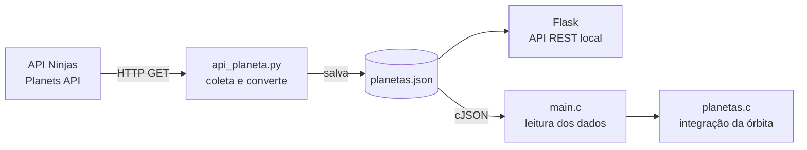

# 🪐 Simulador Orbital

Simulador de órbitas planetárias do Sistema Solar que combina **Python** e **C**. A parte em Python busca dados reais dos planetas numa API pública, calcula as condições iniciais de cada órbita e os disponibiliza numa **API REST** própria. A parte em C lê esses dados e calcula o movimento dos planetas ao redor do Sol com a **Lei da Gravitação Universal de Newton**.

> 🚧 **Projeto em desenvolvimento.** A coleta de dados e a API REST estão funcionais; a integração da simulação física no programa em C está em andamento. Veja o [Roadmap](#-roadmap).

---

## Sumário

1. [Como funciona](#-como-funciona)
2. [A física por trás](#-a-física-por-trás)
3. [Estrutura do projeto](#-estrutura-do-projeto)
4. [Como executar](#-como-executar)
5. [API REST](#-api-rest)
6. [Roadmap](#-roadmap)
7. [Créditos](#-créditos)

---

## ⚙️ Como funciona



1. **Coleta (`api_planeta.py`):** para cada um dos 8 planetas, faz uma requisição à [API Ninjas](https://api-ninjas.com/api/planets) e recebe dados como massa, semieixo maior e período orbital.
2. **Conversão:** transforma as unidades astronômicas da API em unidades do Sistema Internacional (kg, m, s) e calcula a **velocidade orbital média** e o **vetor de estado inicial** (posição e velocidade) de cada planeta.
3. **Armazenamento:** grava tudo em `planetas.json`.
4. **Disponibilização:** um servidor **Flask** expõe os dados por uma API REST, com rotas para listar, consultar e atualizar os planetas.
5. **Simulação (C):** `main.c` lê o JSON com a biblioteca **cJSON**, e `planetas.c` implementa o tipo `Planetas` e a função que avança a órbita no tempo.

---

## 🔭 A física por trás

### Lei da Gravitação Universal

**Definição.** Dois corpos de massas *M* e *m*, separados por uma distância *r*, se atraem com uma força de intensidade

$$F = \frac{G\,M\,m}{r^2}$$

em que *G* = 6,674 × 10⁻¹¹ N·m²/kg² é a constante gravitacional.

**Desenvolvimento.** Pela segunda lei de Newton (*F = m·a*), a massa do planeta se cancela e a aceleração que o Sol (massa *M*☉ = 1,989 × 10³⁰ kg) provoca depende só da posição. Na forma vetorial, com o Sol na origem e o planeta em **r** = (x, y):

$$\vec{a} = -\frac{G\,M_\odot}{|\vec{r}|^3}\,\vec{r} \quad\Rightarrow\quad a_x = -\frac{G M_\odot}{r^3}\,x, \qquad a_y = -\frac{G M_\odot}{r^3}\,y$$

O sinal negativo indica que a aceleração aponta **para o Sol**. É exatamente o que a função `atualizar_orbita` calcula.

### Condições iniciais

O modelo parte de uma **órbita circular** no plano. Cada planeta começa sobre o eixo *x*, a uma distância igual ao seu semieixo maior *a*, com velocidade perpendicular ao raio (tangente à órbita):

$$\vec{r}_0 = (a,\ 0) \qquad \vec{v}_0 = (0,\ v_{média}) \qquad v_{média} = \frac{2\pi a}{T}$$

### Integração numérica

**Definição.** Como a aceleração muda a cada instante, a órbita é calculada em pequenos passos de tempo Δt (**integração numérica**). O método usado é o **Euler semi-implícito**: primeiro atualiza a velocidade com a aceleração atual, depois atualiza a posição com a **velocidade já atualizada**:

$$\vec{v}_{n+1} = \vec{v}_n + \vec{a}_n\,\Delta t \qquad \vec{r}_{n+1} = \vec{r}_n + \vec{v}_{n+1}\,\Delta t$$

**Desenvolvimento.** A ordem das duas linhas importa. No Euler **explícito** (posição atualizada com a velocidade antiga), o planeta ganha energia a cada volta e a órbita se abre numa espiral. O Euler **semi-implícito** é *simplético*: conserva a energia de forma aproximada por longos períodos, e a órbita continua fechada. Quanto menor o Δt, mais precisa a simulação. Um passo de 1 hora (3600 s) já dá bons resultados para os planetas.

### Exemplo — a Terra

| Grandeza | Valor da API | Convertido (SI) |
|---|---|---|
| Semieixo maior *a* | 1 AU | 1,496 × 10¹¹ m |
| Período *T* | 365,25 dias | 3,156 × 10⁷ s |
| Velocidade média 2π*a*/*T* | — | **≈ 29 786 m/s** (≈ 107 000 km/h) |

Como verificação, a velocidade de uma órbita circular também pode ser obtida só pela gravidade, com $v = \sqrt{G M_\odot / r}$ ≈ **29 788 m/s**. Os dois valores coincidem, o que confirma que as condições iniciais são consistentes com a física da simulação.

---

## 📁 Estrutura do projeto

| Arquivo | Linguagem | Função |
|---|---|---|
| `api_planeta.py` | Python | Coleta os dados na API Ninjas, converte unidades, gera `planetas.json` e sobe a API REST com Flask |
| `main.c` | C | Lê `planetas.json` e extrai nome, massa, posição e velocidade de cada planeta |
| `planetas.h` | C | Interface do tipo `Planetas` (tipo opaco: os campos ficam escondidos em `planetas.c`) |
| `planetas.c` | C | Criação/destruição de planetas e a integração da órbita (`atualizar_orbita`) |
| `cJSON.c` / `cJSON.h` | C | Biblioteca de terceiros para ler JSON em C |
| `planetas.json` | JSON | Gerado pelo script Python (não versionado) |

---

## 🚀 Como executar

### Pré-requisitos

- Python 3.9+
- Um compilador C (`gcc` ou `clang`)
- Uma chave gratuita da [API Ninjas](https://api-ninjas.com/register)

### 1. Coletar os dados e subir a API

```bash
pip install requests flask

# a chave da API fica em variável de ambiente, nunca no código
export API_NINJAS_KEY="sua_chave_aqui"

python api_planeta.py
```

O script baixa os dados dos 8 planetas, grava `planetas.json` e inicia o servidor em `http://localhost:5000`.

### 2. Compilar e rodar o programa em C

```bash
gcc main.c planetas.c cJSON.c -o simulador -lm
./simulador
```

O `-lm` liga a biblioteca matemática (`sqrt`, `pow`), usada nos cálculos da órbita.

---

## 🌐 API REST

| Método | Rota | Descrição |
|---|---|---|
| `GET` | `/planetas` | Lista todos os planetas salvos |
| `GET` | `/planetas/<nome>` | Retorna um planeta pelo nome (sem diferenciar maiúsculas/minúsculas) |
| `POST` | `/atualizar` | Busca os dados novamente na API Ninjas e regrava `planetas.json` |

### Exemplos

```bash
curl http://localhost:5000/planetas/earth
```

```json
{
    "nome": "Earth",
    "massa_kg": 5.97e24,
    "raio_orbital_m": 149600000000.0,
    "periodo_dias": 365.25,
    "velocidade_media_m_s": 29785.7,
    "posicao": { "x": 149600000000.0, "y": 0.0 },
    "velocidade": { "x": 0.0, "y": 29785.7 }
}
```

```bash
curl -X POST http://localhost:5000/atualizar
```

```json
{ "mensagem": "Dados atualizados com sucesso.", "total": 8 }
```

Respostas de erro usam o código HTTP correspondente: `404` quando não há dados ou o planeta não existe, e `500` quando a atualização falha.

---

## 🗺️ Roadmap

- [x] Coleta de dados reais dos planetas via API
- [x] Conversão de unidades e cálculo do vetor de estado inicial
- [x] API REST com Flask
- [x] Leitura do JSON em C com cJSON
- [x] Modelo gravitacional e integrador de Euler semi-implícito
- [ ] Conectar `main.c` ao módulo `planetas.c` e rodar o laço de simulação
- [ ] Exportar as trajetórias para CSV
- [ ] Visualizar as órbitas (ex.: Python + Matplotlib)
- [ ] Órbitas elípticas a partir da excentricidade real
- [ ] Interação gravitacional entre planetas (problema de N corpos)
- [ ] Integradores de maior precisão (Velocity Verlet, Runge-Kutta 4)

---

## 📚 Créditos

- Dados planetários: [API Ninjas — Planets API](https://api-ninjas.com/api/planets)
- Leitura de JSON em C: [cJSON](https://github.com/DaveGamble/cJSON), de Dave Gamble (licença MIT)

---

<div align="center">

Desenvolvido por **[Diego Renato](https://github.com/drenato-v)** · 🔭 Interessado em astrofísica e no código que a descreve

</div>
